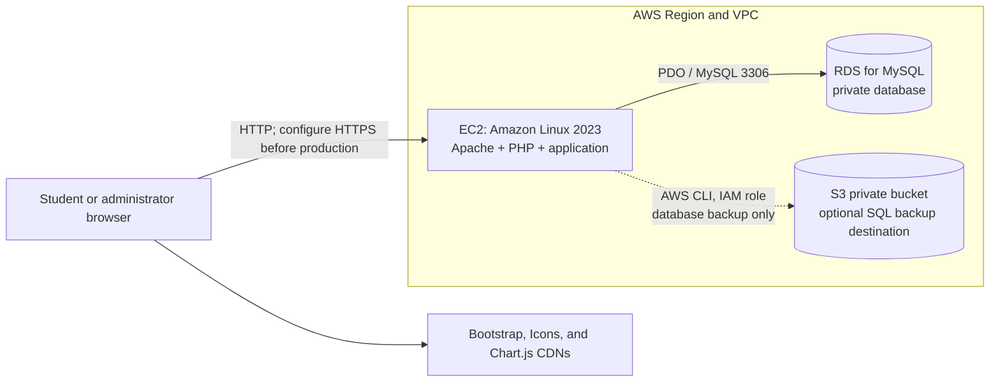
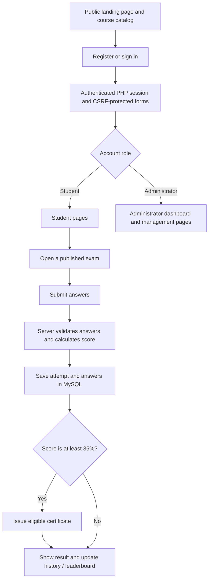

# Online Exam System

A server-rendered PHP and MySQL application for managing online exams, student results, and achievement certificates. It provides public, student, and administrator pages and can run locally with XAMPP or on an Amazon Linux EC2 instance with Amazon RDS for MySQL.

## Project details

### Features

- Student registration, login, profiles, and role-based administrator access.
- Published course catalog with search, category and difficulty filters, sorting, and pagination.
- Twenty-five seeded courses with multiple-choice questions and local course photographs.
- Timed exams, server-side grading, saved answers, result history, and downloadable reports.
- Student leaderboard ranked by total score, with completed attempts as a tie-breaker.
- Silver, Gold, and Platinum certificates based on submitted exam percentage, with PDF downloads and public verification.
- Administrator tools for managing courses, questions, students, exam attempts, certificates, and feedback.
- Responsive interface, dark/light theme, and dashboard charts.

Certificate eligibility is based on actual score divided by maximum marks:

| Percentage | Certificate |
| --- | --- |
| Below 35% | None |
| 35%–49.99% | Silver |
| 50%–79.99% | Gold |
| 80%–100% | Platinum |

Quiz pass/fail status uses the quiz's configured passing percentage and is separate from certificate eligibility.

### Technology stack

| Area | Technology |
| --- | --- |
| Server | PHP 8.0+ (Amazon Linux 2023 currently provides PHP 8.1 in the AWS LAMP guide) |
| Database | MySQL 5.7+ / Amazon RDS for MySQL, InnoDB, `utf8mb4` |
| Data access | PDO MySQL with prepared statements |
| Web server | Apache HTTP Server |
| PDF certificates | Dompdf, installed with Composer |
| Browser | HTML, CSS, JavaScript; Bootstrap, Bootstrap Icons, and Chart.js from CDNs |
| AWS deployment | Amazon Linux 2023 on EC2, private RDS for MySQL, private S3 bucket for optional database backups |

### Architecture

The application is a PHP monolith: Apache serves the PHP pages, PHP contains the business logic, and PDO connects to MySQL. Course thumbnails included in the repository are served from `assets/images/courses/`. Administrator-uploaded thumbnails are saved to `uploads/courses/` on the web server.



S3 is **not** currently used by the PHP application to store uploaded thumbnails. The backup example below uses S3 as a private destination for database dumps. Using S3 for live uploads would require an application storage integration that is not included in this repository.

### Application flow



### Project layout

```text
online-exam-system/
├── admin/                 Administrator pages
├── assets/
│   ├── css/style.css      Shared styles
│   ├── images/courses/    Bundled course thumbnails and attribution
│   ├── img/               Other application images
│   └── js/app.js          Shared browser behavior
├── config/config.php      Default settings and local override loader
├── database/
│   ├── schema.sql         Fresh-install schema and original sample courses
│   └── migrations/        Incremental catalog, thumbnail, and certificate updates
├── includes/              Database, authentication, layout, and certificate helpers
├── tests/                 PHP regression and data validation scripts
├── uploads/courses/       Runtime administrator-uploaded thumbnails
├── install.php            One-time fresh-install setup
├── index.php              Public landing page
├── exams.php              Student course catalog
├── take-exam.php          Timed exam
├── submit-exam.php        Submission and server-side grading
├── result.php             Exam result
├── history.php            Student attempt history
├── leaderboard.php        Student leaderboard
├── certificates.php       Student certificate library
├── certificate.php        Certificate preview
├── certificate-pdf.php    Certificate PDF download
└── verify-certificate.php Public certificate verification
```

## Database

The schema uses InnoDB, foreign keys, and `utf8mb4`. Core tables:

| Table | Purpose |
| --- | --- |
| `users` | Student and administrator accounts |
| `quizzes` | Course and exam settings, publication status, and image path |
| `questions` | Exam questions and marks |
| `options` | Multiple-choice options and correct-answer flags |
| `attempts` | Submitted scores, maximum marks, and attempt metadata |
| `attempt_answers` | Saved answer selections and correctness |
| `feedback` | Student feedback |
| `certificates` | Issued and revoked certificate records |

See [`database/schema.sql`](database/schema.sql) for the full schema. **It drops and recreates application tables. Do not run `install.php` or import this schema against a database containing data you need to keep.**

## Local setup (Windows / XAMPP)

1. Install XAMPP with PHP 8.0+ and MySQL or MariaDB. Ensure the PHP `pdo_mysql`, `mbstring`, and DOM (`dom`) extensions are enabled.
2. Copy or clone the project into the web root, for example `C:\xampp\htdocs\online-exam-system`.
3. Start Apache and MySQL from the XAMPP Control Panel. The default configuration uses host `127.0.0.1`, port `3306`, database `online_exam_system`, user `root`, and an empty password.
4. From PowerShell in the project directory, install PHP dependencies:

   ```powershell
   composer install
   ```

5. If your local database credentials differ from the defaults, create `config\config.local.php` with your own values. This file is ignored by Git:

   ```php
   <?php
   define('DB_HOST', '127.0.0.1');
   define('DB_PORT', 3306);
   define('DB_NAME', 'online_exam_system');
   define('DB_USER', 'root');
   define('DB_PASS', '');
   define('APP_DEBUG', true);
   ```

6. Open <http://localhost/online-exam-system/install.php>, enter the first administrator's details, and run setup. The installer creates the schema and loads the catalog (25 courses, including 215 questions); it can optionally create a demo student.
7. **Delete `install.php` from the web root immediately after setup.** Do not run the installer a second time on a database with data to preserve.
8. To assign the bundled course photographs, run:

   ```powershell
   C:\xampp\php\php.exe C:\xampp\htdocs\online-exam-system\database\migrations\20261030_add_course_thumbnails.php
   ```

Student sign-in: <http://localhost/online-exam-system/login.php>

Administrator sign-in: <http://localhost/online-exam-system/admin/login.php>

The optional demo account is `student@oes.local` / `student@123`. Use it only locally; change or remove it before deploying.

## Deploy to AWS (EC2, RDS, and S3)

This is a single-instance deployment suitable for learning and low traffic, not a highly available production architecture. Use a separate EC2 instance for Apache/PHP, a **private** RDS database, and (optionally) a private S3 bucket for database backups.

> **Free Tier and cost warning:** AWS Free Tier eligibility, account plans, regions, eligible instance classes, storage allowances, and promotional credits change. Before creating resources, check the AWS Billing console's Free Tier and pricing pages for your account and selected Region. If the RDS console shows **Sandbox** rather than **Free tier**, do not assume the resource is free. EC2, RDS, EBS, public IPv4 addresses, data transfer, S3, snapshots, DNS, and TLS/load-balancer choices may incur charges. Set a billing budget/alert; an alert does not cap or stop charges. Stop or delete resources you no longer need.

### 1. Choose a Region and create an S3 backup bucket

1. In the AWS Console, select one Region and use it for EC2, RDS, and S3.
2. Open **S3 → Buckets → Create bucket**. Enter a globally unique name, select the same Region, and keep **Block all public access** enabled and **Object Ownership: Bucket owner enforced**. Keep the default server-side encryption (SSE-S3). Do not add a public bucket policy.
3. Optionally add a prefix such as `oes-backups/` for database dumps. S3 versioning and lifecycle rules are optional and can add storage or request costs.
4. The application does not connect to S3 for uploaded images. The restricted EC2 role and backup example in step 7 are only needed if you choose to send database dumps to this bucket.

### 2. Create an EC2 IAM role for optional S3 backups

Skip this step if you will not use EC2 to upload database dumps to S3.

1. Open **IAM → Roles → Create role**. Select **AWS service → EC2** as the trusted entity.
2. Create a policy that grants only `s3:PutObject` to the backup prefix. Replace `BUCKET_NAME` with the bucket name:

   ```json
   {
     "Version": "2012-10-17",
     "Statement": [
       {
         "Effect": "Allow",
         "Action": "s3:PutObject",
         "Resource": "arn:aws:s3:::BUCKET_NAME/oes-backups/*"
       }
     ]
   }
   ```

3. Attach this policy to the EC2 role, give the role a name such as `oes-ec2-s3-backup`, and use it when launching EC2. Do not put AWS access keys in the project or on the instance.

### 3. Launch the Amazon Linux EC2 instance

1. Open **EC2 → Instances → Launch instances** in the selected Region.
2. Choose **Amazon Linux 2023 AMI**, preferably the x86_64 image for the commands below. Choose an instance type that the console explicitly marks eligible for your account's free offer; eligibility is not guaranteed for every account or Region.
3. Create or select a key pair and keep its private key secure.
4. Create an EC2 security group with:
   - SSH, TCP 22, only from your current IP (`/32`), or use a properly configured Session Manager connection instead.
   - Do not expose HTTP or HTTPS publicly until HTTPS is configured. For initial setup and testing, use the SSH tunnel described below.
   - Do **not** open MySQL port 3306 on this group to the internet.
5. Select the IAM role from step 2 if using S3 backups. Launch the instance and wait until it is running.

### 4. Create a private RDS for MySQL database

1. Open **RDS → Databases → Create database**. Choose **Standard create** for network and backup controls, then select **MySQL**.
2. Choose a currently supported RDS for MySQL version; the application schema is compatible with MySQL 5.7 and later. Set an identifier and strong master username/password; store the password in a password manager.
3. Select a DB class and storage size only after checking the pricing/Free Tier eligibility for this account and Region. For a learning deployment, keep Multi-AZ and optional paid add-ons off unless you have budgeted for them.
4. In **Connectivity**, use the same VPC as EC2, set **Public access: No**, and attach a DB security group. Prefer private subnets in the DB subnet group. Add an inbound MySQL rule (TCP 3306) to that security group with the **EC2 security group as the source**. Do not use `0.0.0.0/0`. If the console offers **Connect to an EC2 compute resource**, selecting your EC2 instance can configure VPC connectivity and security groups automatically; still verify the resulting inbound rule and that public access is disabled.
5. Set the initial database name to `online_exam_system` if the create workflow offers it. Keep automated backups enabled if the selected account/class supports them and confirm the retention/storage charges.
6. Create the DB and wait for status **Available**. From the RDS details page, copy the endpoint hostname (not a URL); the endpoint is the `DB_HOST` value below. Use port `3306`.

The EC2 and RDS security groups must permit the path EC2 → RDS. A private RDS instance cannot be reached from your laptop unless you deliberately configure a secure network path; do not make it public just to run setup.

### 5. Install Apache, PHP, and deploy the application

Connect to the instance using **EC2 Instance Connect**, **Session Manager**, or SSH restricted to your IP. Amazon Linux 2023 package versions can change; confirm that installed PHP meets the project's PHP 8.0+ requirement.

```bash
sudo dnf upgrade -y
sudo dnf install -y httpd php-fpm php-mysqli php-json php-mbstring php-xml php-gd php php-devel git unzip curl mariadb105
sudo systemctl enable --now httpd php-fpm
php -v
php -m | grep -E 'PDO|pdo_mysql|mysqli'
```

The application accepts course thumbnails up to 5 MB. In `/etc/php.ini`, set `upload_max_filesize = 6M` and `post_max_size = 8M`, then apply the settings:

```bash
sudo systemctl restart php-fpm
```

Clone your repository into Apache's web root (replace the URL with your repository):

```bash
cd /var/www/html
sudo git clone --branch main https://github.com/OWNER/REPOSITORY.git online-exam-system
sudo chown -R ec2-user:apache /var/www/html/online-exam-system
```

For a private repository, use a dedicated read-only deploy key; do not put a personal access token in the clone URL or shell history. Install Composer if it is not already available, verifying the official installer checksum:

```bash
EXPECTED_CHECKSUM="$(curl -fsSL https://composer.github.io/installer.sig)"
curl -fsSLo composer-setup.php https://getcomposer.org/installer
ACTUAL_CHECKSUM="$(php -r "echo hash_file('sha384', 'composer-setup.php');")"
if [ "$EXPECTED_CHECKSUM" != "$ACTUAL_CHECKSUM" ]; then
  echo 'Composer installer checksum mismatch' >&2
  rm composer-setup.php
  exit 1
fi
sudo php composer-setup.php --install-dir=/usr/local/bin --filename=composer
rm composer-setup.php
```

Then install production dependencies:

```bash
cd /var/www/html/online-exam-system
composer install --no-dev --optimize-autoloader
```

Allow PHP/Apache to write only to the administrator-upload directory:

```bash
sudo chown -R apache:apache /var/www/html/online-exam-system/uploads/courses
sudo chmod 0750 /var/www/html/online-exam-system/uploads/courses
```

The bundled course thumbnails under `assets/images/courses/` must also be present in the deployed checkout.

### 6. Configure RDS credentials, install the schema, and secure the app

1. Create `/var/www/html/online-exam-system/config/config.local.php` on the EC2 instance. Do not commit this file. Initially use the RDS master credentials for the one-time installer:

   ```php
   <?php
   define('DB_HOST', 'YOUR-RDS-ENDPOINT');
   define('DB_PORT', 3306);
   define('DB_NAME', 'online_exam_system');
   define('DB_USER', 'YOUR_RDS_MASTER_USERNAME');
   define('DB_PASS', 'YOUR_RDS_MASTER_PASSWORD');
   define('APP_DEBUG', false);
   ```

   Use the endpoint hostname as-is, with no `https://` and no `:3306` suffix. Set file permissions so the web-server account can read this file but other users cannot:

   ```bash
   sudo chown ec2-user:apache /var/www/html/online-exam-system/config/config.local.php
   sudo chmod 0640 /var/www/html/online-exam-system/config/config.local.php
   ```

2. From your local PowerShell terminal, open an SSH tunnel to the instance (replace the key and host values):

   ```powershell
   ssh -i C:\path\to\your-key.pem -L 8080:127.0.0.1:80 ec2-user@EC2-PUBLIC-DNS
   ```

   Keep this terminal open, then visit `http://localhost:8080/online-exam-system/install.php` in your browser. The browser connection is forwarded through SSH; do not expose the installer or send its credentials over public HTTP. Create a unique administrator account and run the installer **once**. The installer schema drops and recreates application tables, so never re-run it on a database with data to preserve.
3. Immediately remove the installer:

   ```bash
   sudo rm /var/www/html/online-exam-system/install.php
   ```

4. Assign the bundled course photographs to the seeded courses:

   ```bash
   cd /var/www/html/online-exam-system
   php database/migrations/20261030_add_course_thumbnails.php
   ```

5. For normal app operation, create a separate database user with only the CRUD permissions the application needs. Connect to RDS from the EC2 instance using the RDS master account, then run the following in the MySQL client, replacing the example password with a new strong password:

   ```sql
   CREATE USER 'oes_app'@'%' IDENTIFIED BY 'REPLACE_WITH_A_STRONG_UNIQUE_PASSWORD';
   GRANT SELECT, INSERT, UPDATE, DELETE ON online_exam_system.* TO 'oes_app'@'%';
   ```

   The database security group still limits network access to EC2. Do not put the example password into shell history or source control. Update `DB_USER` and `DB_PASS` in `config.local.php` to the `oes_app` credentials. Keep privileged database credentials out of the web application's normal runtime configuration.

6. Restrict direct web access to private source/configuration directories and directory listings. Create `/etc/httpd/conf.d/oes-security.conf`:

   ```apache
   <DirectoryMatch "^/var/www/html/online-exam-system/(\.git|config|database|includes|tests|vendor)(/|$)">
       Require all denied
   </DirectoryMatch>

   <Directory "/var/www/html/online-exam-system">
       Options -Indexes
       AllowOverride None
       Require all granted
   </Directory>

   <Directory "/var/www/html/online-exam-system/uploads">
       Options -Indexes
       <FilesMatch "\.(php[0-9]?|phtml|phar)$">
           Require all denied
       </FilesMatch>
   </Directory>
   ```

   Then check the Apache configuration and reload it:

   ```bash
   sudo httpd -t
   sudo systemctl reload httpd
   ```

7. Configure HTTPS before allowing public access or using real student accounts or exam data. One AWS Console option is to request a DNS-validated certificate in **AWS Certificate Manager**, create an internet-facing **Application Load Balancer** in public subnets with a 443 listener using that certificate, and forward it to an EC2 target group on port 80. Allow inbound 443 from the internet to the load balancer security group, and allow inbound port 80 to EC2 **only from the load balancer security group**. Keep RDS access limited to the EC2 security group. This requires a domain and adds resources that may be outside the Free Tier; check pricing first. Until HTTPS is ready, keep the application accessible only through the SSH tunnel.

   The current PDO connection does not configure TLS certificate verification for RDS. Before handling real student data, add and verify RDS TLS in the database connection layer as well as HTTPS for browser traffic.

### 7. (Optional) Upload an RDS dump to S3

RDS automated backups/snapshots and S3 object backups are separate mechanisms. This example creates a logical SQL dump from EC2 and uploads it using the instance role; it does not change the app's image-upload behavior.

1. Confirm the EC2 instance has the restricted S3 role, the bucket is private, and AWS CLI v2 is installed. Follow the [official AWS CLI installation guide](https://docs.aws.amazon.com/cli/latest/userguide/getting-started-install.html) if needed. Do not configure long-lived access keys.
2. Install a MySQL-compatible client if `mysqldump` is not present (`mariadb105` provides the client on Amazon Linux 2023). From the EC2 instance, set the endpoint and bucket name and run:

   ```bash
   set -o pipefail
   DB_HOST='YOUR-RDS-ENDPOINT'
   DB_NAME='online_exam_system'
   BUCKET_NAME='YOUR-PRIVATE-BUCKET'

   mysqldump --host="$DB_HOST" --port=3306 --user=oes_app --password \
     --single-transaction "$DB_NAME" \
     | gzip \
     | aws s3 cp - "s3://$BUCKET_NAME/oes-backups/online_exam_system-$(date -u +%Y%m%dT%H%M%SZ).sql.gz" \
         --sse AES256
   ```

   `--password` prompts for the database password. Verify the uploaded object appears under the `oes-backups/` prefix in the S3 console. Protect backups as sensitive data, periodically test a restore, and configure retention deliberately to avoid unexpected storage charges.

### 8. Validate the deployment

- Open the EC2 site and confirm the landing page loads without PHP errors.
- Sign in as the administrator and verify catalog, question, and certificate pages.
- Run a student exam and check that its attempt, result, and any eligible certificate are saved in RDS.
- Confirm administrator thumbnail uploads work and that uploaded files are stored under `uploads/courses/`.
- Verify that `/install.php`, `/config/config.local.php`, `/database/schema.sql`, and `/vendor/` cannot be fetched over HTTP.
- Verify RDS is not publicly accessible and its security group accepts MySQL only from the EC2 security group.
- If using S3 backups, confirm the object is private and can be restored in a separate test database.

## Updating an existing installation

Back up the database before applying migrations. Do not run `install.php` against an existing installation.

### Course catalog

The catalog migration is additive and idempotent. It adds missing difficulty fields and inserts the 20 additional courses and their questions without deleting the original five courses or existing attempts:

```powershell
C:\xampp\php\php.exe C:\xampp\htdocs\online-exam-system\database\migrations\20261030_expand_course_catalog.php
```

### Course photographs

Run the thumbnail migration after all 25 courses are present. It maps existing courses by verified ID or unique exact title and assigns local photographs without changing questions:

```powershell
C:\xampp\php\php.exe C:\xampp\htdocs\online-exam-system\database\migrations\20261030_add_course_thumbnails.php
```

Course photographs are stored in [`assets/images/courses/`](assets/images/courses/). Their source IDs and license information are documented in [`assets/images/courses/ATTRIBUTION.txt`](assets/images/courses/ATTRIBUTION.txt). The administrator quiz form accepts optional JPEG, PNG, or WebP thumbnails up to 5 MB.

### Certificates

The current schema includes the certificates table. To add it to an older database that does not have it, import [`database/migrations/20261030_create_certificates.sql`](database/migrations/20261030_create_certificates.sql) using a database account with the required DDL permissions. Eligible completed attempts are issued certificates automatically. Opening **My Certificates** also performs an idempotent backfill for eligible historical attempts. A unique attempt constraint prevents duplicate certificates.

## Checks

Run these commands from the project directory. The catalog and thumbnail checks use the configured database and require the seeded 25-course installation. The certificate rules check validates certificate percentage boundaries and record consistency.

```powershell
C:\xampp\php\php.exe tests\certificate-rules.php
C:\xampp\php\php.exe tests\course-catalog.php
C:\xampp\php\php.exe tests\course-thumbnails.php
```

## Security notes

- Passwords are stored as hashes; never store plain-text passwords.
- Database access uses PDO prepared statements, and state-changing forms use CSRF protection.
- Keep environment-specific database credentials in the ignored `config/config.local.php`; do not commit secrets.
- Set `APP_DEBUG` to `false` in production and remove `install.php` immediately after setup.
- Restrict database access to the application host, disable directory listings, and block web access to source/configuration directories.
- Configure HTTPS before collecting real credentials or exam data.
- The current PDO configuration does not verify an RDS TLS certificate; add database TLS before using real student data.
- Uploaded course thumbnails remain on the EC2 filesystem. Back up `uploads/courses/` separately or add an S3 storage integration if persistent shared storage is required.

## Troubleshooting

- **Database connection error:** Confirm the RDS endpoint, port, database name, user, and password in `config/config.local.php`; check that RDS is available and its security group allows TCP 3306 from the EC2 security group.
- **Database connection timeout:** Confirm both resources are in the intended VPC and that the RDS inbound rule references the EC2 security group, not a public IP.
- **Certificate PDF unavailable:** Run `composer install --no-dev --optimize-autoloader` and verify `vendor/` exists.
- **Course thumbnails missing:** Confirm `assets/images/courses/` was deployed and run the thumbnail migration. For admin uploads, confirm Apache can write to `uploads/courses/`.
- **CSRF token or login issues:** Check that PHP sessions can be written by the web-server account and that the browser is using the configured HTTPS host consistently.

## AWS references

- [Amazon Linux 2023 LAMP tutorial](https://docs.aws.amazon.com/linux/al2023/ug/ec2-lamp-amazon-linux-2023.html)
- [Create and connect to an RDS for MySQL database](https://docs.aws.amazon.com/AmazonRDS/latest/UserGuide/CHAP_GettingStarted.CreatingConnecting.MySQL.html)
- [Amazon RDS DB instance connectivity](https://docs.aws.amazon.com/AmazonRDS/latest/UserGuide/CHAP_CommonTasks.Connect.html)
- [Create an Amazon S3 bucket](https://docs.aws.amazon.com/AmazonS3/latest/userguide/create-bucket-overview.html)
- [Install the AWS CLI](https://docs.aws.amazon.com/cli/latest/userguide/getting-started-install.html)
