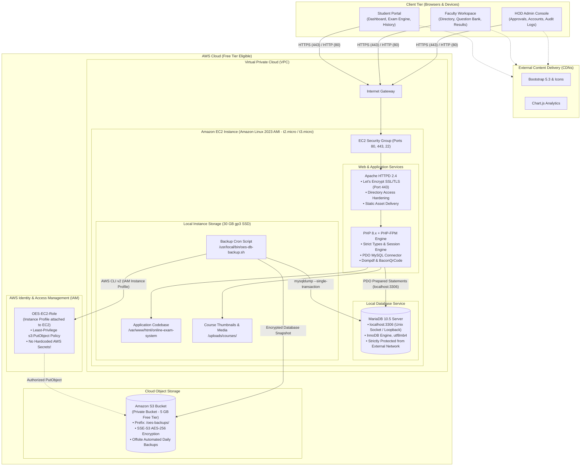
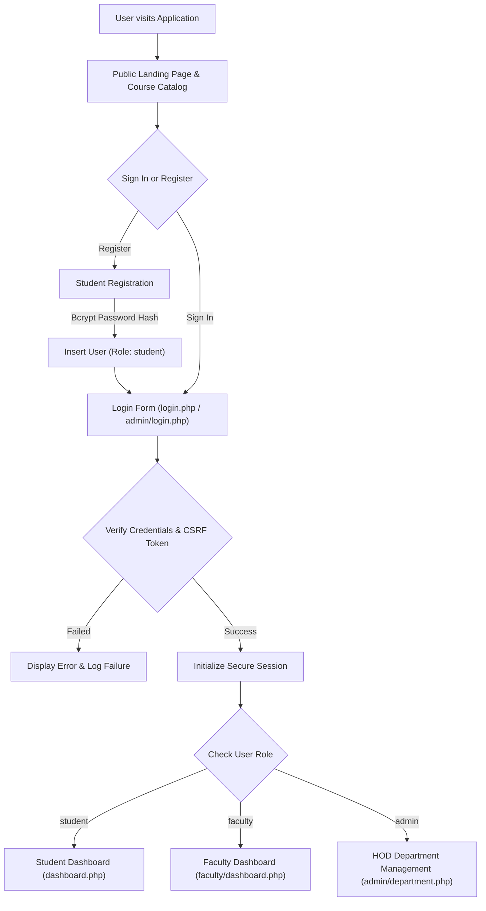
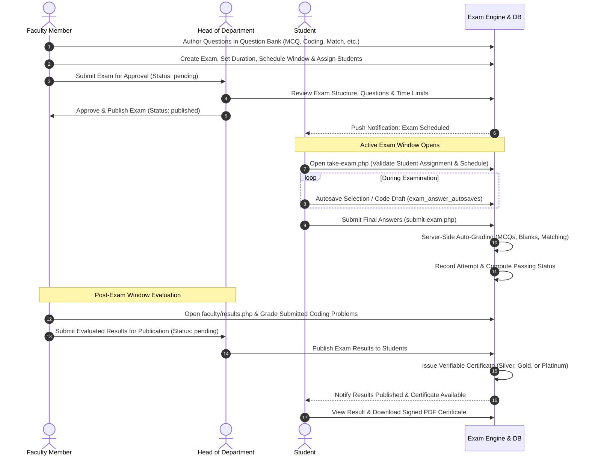
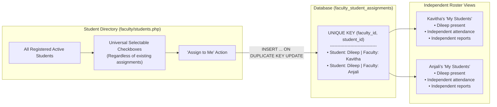
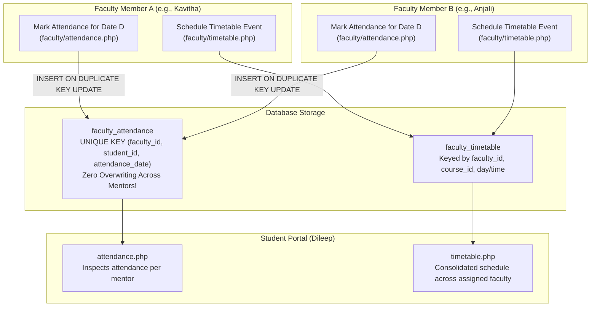

# Online Examination System (OES)

A comprehensive, secure, and production-ready server-rendered web application built with **PHP 8.x** and **MySQL / MariaDB**. Designed for colleges, universities, and training institutes, the platform delivers role-based access for **Students**, **Faculty**, and **Administrators / Heads of Department (HOD)**. It provides end-to-end exam lifecycle management: rich question authoring, multi-faculty student mentoring, scheduled and timed examinations, automated and manual code evaluations, instant result generation, verifiable achievement certificates with QR codes, and performance analytics.

---

## Table of Contents

- [Project Overview](#project-overview)
- [Key Features](#key-features)
  - [Role-Based Access](#role-based-access)
  - [Multiple Faculty–Student Assignments](#multiple-facultystudent-assignments)
  - [Exam Lifecycle & Question Authoring](#exam-lifecycle--question-authoring)
  - [Student Experience & Verifiable Certificates](#student-experience--verifiable-certificates)
  - [Daily Attendance & Academic Timetable](#daily-attendance--academic-timetable)
- [Technology Stack](#technology-stack)
- [System Architecture (AWS EC2 & S3)](#system-architecture-aws-ec2--s3)
- [Application Flow & Workflows](#application-flow--workflows)
  - [Authentication & Role Routing](#authentication--role-routing)
  - [Examination & Grading Lifecycle](#examination--grading-lifecycle)
  - [Multiple Faculty–Student Assignment Flow](#multiple-facultystudent-assignment-flow)
  - [Attendance & Timetable Isolation Flow](#attendance--timetable-isolation-flow)
- [Project Directory Structure](#project-directory-structure)
- [Database Schema & Architecture](#database-schema--architecture)
- [Local Setup Guide (Windows / XAMPP)](#local-setup-guide-windows--xampp)
- [AWS Production Deployment (EC2 & S3 on AWS Free Tier)](#aws-production-deployment-ec2--s3-on-aws-free-tier)
  - [AWS Free Tier Strategy & Architecture](#aws-free-tier-strategy--architecture)
  - [Step 1: Create Amazon S3 Bucket in AWS Console](#step-1-create-amazon-s3-bucket-in-aws-console)
  - [Step 2: Create IAM Policy & IAM Role for EC2](#step-2-create-iam-policy--iam-role-for-ec2)
  - [Step 3: Create EC2 Security Group](#step-3-create-ec2-security-group)
  - [Step 4: Launch Amazon Linux 2023 (AL2023) EC2 Instance](#step-4-launch-amazon-linux-2023-al2023-ec2-instance)
  - [Step 5: Connect to the Amazon Linux EC2 Instance](#step-5-connect-to-the-amazon-linux-ec2-instance)
  - [Step 6: Install Apache, MariaDB & PHP 8.x on Amazon Linux 2023](#step-6-install-apache-mariadb--php-8x-on-amazon-linux-2023)
  - [Step 7: Initialize & Secure MariaDB Database Server](#step-7-initialize--secure-mariadb-database-server)
  - [Step 8: Deploy Codebase & Composer Dependencies](#step-8-deploy-codebase--composer-dependencies)
  - [Step 9: Import Database Schema & Run Migrations](#step-9-import-database-schema--run-migrations)
  - [Step 10: Configure Production Database Credentials](#step-10-configure-production-database-credentials)
  - [Step 11: Apache Hardening & Directory Permissions](#step-11-apache-hardening--directory-permissions)
  - [Step 12: Automated Database Backups to Amazon S3 via Cron](#step-12-automated-database-backups-to-amazon-s3-via-cron)
  - [Step 13: Free SSL/TLS with Let's Encrypt (Certbot)](#step-13-free-ssltls-with-lets-encrypt-certbot)
- [Verification & Testing Checklist](#verification--testing-checklist)
- [Security Best Practices](#security-best-practices)
- [Troubleshooting Guide](#troubleshooting-guide)
- [License](#license)

---

## Project Overview

The **Online Examination System (OES)** provides educational institutions with a self-hosted, modular platform for running academic assessments without external software lock-in or recurring subscription fees.

Traditional academic portals often suffer from rigid hierarchy where a student can only belong to a single mentor or class. OES eliminates this bottleneck by implementing a **Many-to-Many Faculty–Student Relationship Model**: a student can be independently assigned to multiple faculty mentors simultaneously across courses, subjects, and departments. Mentors independently track attendance, set timetable events, and monitor academic progress without interfering with other faculty members' records.

The system incorporates anti-cheating mechanisms, live client-side autosaving, automated and manual grading pipelines, cryptographic certificate verification, and real-time performance analytics.

---

## Key Features

### Role-Based Access

| Role | Access Scope & Responsibilities |
| :--- | :--- |
| **Student** | Access published course catalog, take scheduled timed exams with live autosaving, view attendance and timetable across all assigned faculty mentors, inspect graded attempts, download signed vector PDF certificates, and track rank on leaderboard. |
| **Faculty** | Author multi-type questions in personal question banks, draft and submit exams for HOD approval, assign students from universal directory, conduct independent daily attendance, record timetable events, evaluate student programming submissions, and track class analytics. |
| **HOD / Super Admin** | Review and approve/reject drafted exams, publish final exam results to students, manage department faculty and student accounts, configure mentor capacity thresholds, inspect system audit logs, and oversee institutional performance. |

### Multiple Faculty–Student Assignments
- **Universal Directory Access**: Faculty members can view all active registered students in the institution.
- **Independent Assignment**: Any student can be selected and assigned by multiple faculty members simultaneously.
- **Non-Destructive Mentorship**: Assigning a student to a faculty member never removes existing assignments from other faculty members.
- **Roster Isolation**: Attendance rosters, student reports, and individual performance analytics strictly isolate data to each faculty member's assigned cohort.
- **Independent Removal**: Removing an assignment by one faculty member has zero impact on the student's status with other mentors.
- **HOD Oversight**: The HOD can view all assignment linkages per student and manage individual relationships.

### Exam Lifecycle & Question Authoring
- **Five Question Types**:
  1. *Multiple Choice Questions (MCQ)*: Single/multiple correct choices with randomized options.
  2. *Fill in the Blanks*: Case-insensitive string token validation.
  3. *True / False*: Boolean validation.
  4. *Match the Following*: Key-value pairing grid with dynamic drag/select evaluation.
  5. *Coding / Programming*: Custom problem statements, input/output specifications, coding constraints, and manual faculty evaluation workflow with marks and feedback.
- **Multi-State Exam Workflow**: `Draft` &rarr; `Pending HOD Approval` &rarr; `Approved` &rarr; `Published` &rarr; `Completed`.
- **Scheduled Time Windows**: Strict window enforcement (`scheduled_start` to `scheduled_end`) with synchronized client-side countdown clocks.
- **Live Autosave Engine**: Asynchronous saving of student answers and review flags (`exam_answer_autosaves`), preventing data loss during network disruptions.

### Student Experience & Verifiable Certificates
- **Anti-Cheating Mechanisms**: Tab-switch detection warnings, full-screen mode enforcement, right-click and copy-paste restrictions during active examinations.
- **Automated Certificate Issuance**: Instant eligibility computation upon exam submission:
  - **Silver Certificate**: 35.00% – 49.99%
  - **Gold Certificate**: 50.00% – 79.99%
  - **Platinum Certificate**: 80.00% – 100.00%
- **Cryptographic Certificate Verification**: Each certificate carries a unique 32-character ID and 64-character SHA-256 verification token, accompanied by a public verification URL and scannable QR code.
- **PDF Generation**: High-resolution, printable PDF certificates generated server-side using Dompdf.

### Daily Attendance & Academic Timetable
- **Independent Attendance**: Each faculty records daily attendance (`present`, `absent`, `late`, `excused`) for their assigned students.
- **Zero Collision Guarantee**: Unique constraints ensure one faculty's attendance entry never overwrites another faculty's record for the same student on the same date.
- **Student Visibility**: Students view attendance percentages broken down by mentor and course.

---

## Technology Stack

```
Frontend:            HTML5, CSS3, JavaScript (ES6+), Bootstrap 5.3.3, Bootstrap Icons, Chart.js 4.4
Backend:             PHP 8.0+ (Strict Types, PDO MySQL, Session Management, CSRF Tokens)
Database:            MySQL 8.0+ / MariaDB 10.5+ (InnoDB Engine, utf8mb4_unicode_ci)
PDF Engine:          Dompdf & BaconQrCode (Composer managed)
Web Server:          Apache HTTP Server 2.4 (mod_php / php-fpm)
Cloud Infrastructure:AWS Free Tier (Amazon EC2 AL2023 AMI, Amazon S3, IAM Roles, VPC Security Groups)
```

| Component | Technology | Version / Specification | Purpose |
| :--- | :--- | :--- | :--- |
| **Runtime** | PHP | 8.0 / 8.1 / 8.2 / 8.3 | Core server-side application logic |
| **Database** | MariaDB / MySQL | MariaDB 10.5+ / MySQL 8.0 | Relational data persistence with strict foreign keys |
| **Web Server** | Apache HTTP Server | 2.4.x | Reverse proxy, static asset delivery, and PHP-FPM host |
| **CSS Framework** | Bootstrap | 5.3.3 (via CDN) | Responsive layout and UI components |
| **Icons** | Bootstrap Icons | 1.11.x (via CDN) | Application iconography |
| **Charts** | Chart.js | 4.4.x (via CDN) | Interactive analytics and performance visualization |
| **PDF Generation** | Dompdf | 2.0+ (via Composer) | Server-side vector certificate rendering |
| **QR Code Engine** | BaconQrCode | 2.0+ (via Composer) | Verification QR generation for certificates |
| **OS (Cloud AMI)** | Amazon Linux 2023 | AL2023 (x86_64, minimal) | Hardened, RPM-based AWS Linux distribution |
| **Cloud Storage** | Amazon S3 | Standard Tier (5 GB Free) | Secure offsite database backups and asset archival |
| **Cloud Compute** | Amazon EC2 | `t2.micro` / `t3.micro` | 750 free hours/month running full LAMP stack |
| **Security / IAM** | AWS IAM | Instance Profile Role | Credential-free AWS CLI access to Amazon S3 |

---

## System Architecture (AWS EC2 & S3)

The application implements a robust, single-instance **LAMP Architecture** backed by **Amazon S3** object storage, completely optimized for the **AWS Free Tier**. All dynamic requests are processed locally on the Amazon Linux EC2 instance, while automated backups and asset snapshots are securely dispatched to a private Amazon S3 bucket using an attached IAM role.



---

## Application Flow & Workflows

### Authentication & Role Routing



### Examination & Grading Lifecycle



### Multiple Faculty–Student Assignment Flow



### Attendance & Timetable Isolation Flow



---

## Project Directory Structure

```text
online-exam-system/
├── admin/                     # HOD and Super Administrator Console
│   ├── _nav.php               # Admin sidebar navigation
│   ├── activity.php           # System-wide audit logs and account events
│   ├── analytics.php          # Institutional exam and student analytics
│   ├── approvals.php          # Faculty exam review and approval workflow
│   ├── attempts.php           # Master student exam attempt logs
│   ├── certificates.php       # Certificate revocation and issuance review
│   ├── dashboard.php          # HOD summary metrics and pending tasks
│   ├── department.php         # Faculty/student accounts, limits & assignments
│   ├── exams.php              # All managed exams and workflows
│   ├── feedback.php           # User feedback inspection
│   ├── login.php              # Dedicated administrative login entry
│   ├── questions.php          # Question management across courses
│   ├── quizzes.php            # Course catalog administration
│   ├── result-approvals.php   # Final exam result publication approval
│   ├── search.php             # Global entity search (students, faculty, exams)
│   ├── settings.php           # System configuration
│   └── users.php              # User account status and credentials
│
├── faculty/                   # Faculty Mentorship and Exam Workspace
│   ├── _nav.php               # Faculty navigation sidebar
│   ├── analytics.php          # Performance analytics for assigned students
│   ├── announcements.php      # Class and exam announcements
│   ├── attendance.php         # Date-wise attendance entry & CSV export
│   ├── dashboard.php          # Assigned students summary, upcoming exams
│   ├── exams.php              # Exam drafting, scheduling & student selection
│   ├── question-bank.php      # Reusable multi-type question bank
│   ├── reports.php            # Attendance, score, and progress report exports
│   ├── results.php            # Manual coding evaluation & result submission
│   ├── students.php           # Student directory & multi-mentor assignment
│   └── timetable.php          # Faculty academic calendar events
│
├── config/
│   ├── config.php             # Core configuration (defaults, timeouts, error rules)
│   └── config.local.php       # Git-ignored local database and environment secrets
│
├── database/
│   ├── schema.sql             # Full database schema and seed content
│   └── migrations/            # Idempotent database migrations
│       ├── 20261030_add_course_thumbnails.php
│       ├── 20261030_create_certificates.sql
│       ├── 20261030_expand_course_catalog.php
│       ├── 20261106_add_department_accounts.php
│       ├── 20261106_add_exam_workflow.php
│       ├── 20261106_add_question_types.php
│       ├── 20261108_add_faculty_workspace.php
│       └── 20261108_upgrade_academic_certificates.php
│
├── includes/                  # Core Application Framework Helpers
│   ├── auth.php               # Session security, CSRF protection, RBAC checks
│   ├── certificate-template.php # Certificate layout markup
│   ├── certificates.php       # Certificate generation, tokens, and verification
│   ├── db.php                 # Singleton PDO database connector
│   ├── exam-workflows.php     # Exam workflow validation and schedules
│   ├── faculty-tools.php      # Mentorship, timetable validation & helper routines
│   ├── footer.php             # Global shared footer
│   ├── functions.php          # Sanitation, formatting, email validation
│   ├── header.php             # Global HTML head, topbar, and layout frames
│   ├── question-types.php     # Evaluation logic for MCQ, Blanks, Match & Code
│   └── student-nav.php        # Student portal sidebar navigation
│
├── assets/
│   ├── css/
│   │   ├── style.css          # Main theme, responsive grids, public styling
│   │   └── student-dashboard.css # Student shell sidebar and cards
│   ├── images/courses/        # Bundled course thumbnails
│   └── js/app.js              # Theme switcher, exam timer, CSRF handlers
│
├── tests/                     # Automated PHP CLI Test Scripts
│   ├── exam-workflow.php
│   ├── faculty-attendance.php
│   ├── faculty-student-directory.php
│   ├── multiple-faculty-assignments.php
│   └── student-workspace.php
│
├── uploads/courses/           # Administrator-uploaded course thumbnails
├── composer.json              # PHP dependencies (Dompdf, BaconQrCode)
├── dashboard.php              # Student dashboard
├── take-exam.php              # Interactive exam engine with autosave
├── submit-exam.php            # Exam submission and automated grading
├── result.php                 # Detailed attempt result inspection
├── timetable.php              # Student personalized timetable
├── attendance.php             # Student personalized attendance view
├── certificate.php            # Certificate HTML preview
├── certificate-pdf.php        # Certificate PDF download endpoint
├── verify-certificate.php     # Public certificate verification
└── index.php                  # Public landing page and course browser
```

---

## Database Schema & Architecture

The database enforces strict referential integrity using **InnoDB** with `utf8mb4_unicode_ci` encoding.

```
┌─────────────────────────────────┐       ┌─────────────────────────────────┐
│              users              │       │        faculty_profiles         │
├─────────────────────────────────┤       ├─────────────────────────────────┤
│ id (PK)                         │◄──────│ user_id (PK, FK)                │
│ name, email, password_hash      │       │ branch, subject, max_students   │
│ role (student, faculty, admin)  │       └─────────────────────────────────┘
│ is_active, created_at           │
└───────────────┬─────────────────┘       ┌─────────────────────────────────┐
                │                         │        student_profiles         │
                ├────────────────────────►│ user_id (PK, FK)                │
                │                         │ registration_no (UQ), branch    │
                │                         │ semester, academic_year         │
                │                         └─────────────────────────────────┘
                │
                │ 1:M                     ┌─────────────────────────────────┐
                ├────────────────────────►│   faculty_student_assignments   │
                │                         ├─────────────────────────────────┤
                │                         │ id (PK)                         │
                │                         │ faculty_id (FK), student_id(FK) │
                │                         │ UNIQUE KEY (faculty_id, student)│
                │                         └─────────────────────────────────┘
                │
                │ 1:M                     ┌─────────────────────────────────┐
                ├────────────────────────►│       faculty_attendance        │
                │                         ├─────────────────────────────────┤
                │                         │ id (PK)                         │
                │                         │ faculty_id (FK), student_id(FK) │
                │                         │ attendance_date, status         │
                │                         │ UNIQUE (faculty, student, date) │
                │                         └─────────────────────────────────┘
                │
                │ 1:M                     ┌─────────────────────────────────┐
                └────────────────────────►│             quizzes             │
                                          ├─────────────────────────────────┤
                                          │ id (PK), title, tag, duration   │
                                          │ passing_percent, is_published   │
                                          └───────────────┬─────────────────┘
                                                          │
                    ┌─────────────────────────────────────┼─────────────────────────────────────┐
                    ▼ 1:M                                 ▼ 1:1                                 ▼ 1:M
    ┌───────────────────────────────┐     ┌───────────────────────────────┐     ┌───────────────────────────────┐
    │           questions           │     │        exam_workflows         │     │    exam_assigned_students     │
    ├───────────────────────────────┤     ├───────────────────────────────┤     ├───────────────────────────────┤
    │ id (PK), quiz_id (FK), text   │     │ quiz_id (PK, FK)              │     │ quiz_id (PK, FK)              │
    │ marks, question_type, code... │     │ faculty_id (FK), status       │     │ student_id (PK, FK)           │
    └───────────────┬───────────────┘     │ scheduled_start, scheduled_end│     └───────────────────────────────┘
                    │                     │ result_status, hod_remarks    │
                    ▼ 1:M                 └───────────────────────────────┘
    ┌───────────────────────────────┐
    │            options            │
    ├───────────────────────────────┤
    │ id (PK), question_id (FK)     │
    │ text, is_correct              │
    └───────────────────────────────┘
```

---

## Local Setup Guide (Windows / XAMPP)

Follow these steps to run the application on a local development machine using XAMPP:

### 1. Prerequisites
- [XAMPP for Windows](https://www.apachefriends.org/) with **PHP 8.0 or higher** and **MySQL / MariaDB**.
- [Composer](https://getcomposer.org/) for managing PHP packages.
- [Git](https://git-scm.com/).

### 2. Clone the Project
Clone the repository into the XAMPP web root (`C:\xampp\htdocs\`):

```powershell
cd C:\xampp\htdocs
git clone https://github.com/YOUR_USERNAME/online-exam-system.git
cd online-exam-system
```

### 3. Install Dependencies
Run Composer in the project root to install Dompdf and BaconQrCode:

```powershell
composer install
```

### 4. Enable Required PHP Extensions
Open `C:\xampp\php\php.ini` in a text editor and ensure the following extensions are enabled (remove any leading `;`):

```ini
extension=pdo_mysql
extension=mbstring
extension=gd
extension=curl
extension=openssl
extension=fileinfo
```

Save the file and restart Apache in the XAMPP Control Panel.

### 5. Start Services & Setup Database
1. Open the **XAMPP Control Panel** and click **Start** for **Apache** and **MySQL**.
2. Open your browser and navigate to **phpMyAdmin**: `http://localhost/phpmyadmin/`.
3. Create a new database named `online_exam_system` with collation `utf8mb4_unicode_ci`.
4. Import the file `database/schema.sql` into the newly created database.
5. Run the course thumbnail migration:
   ```powershell
   C:\xampp\php\php.exe database\migrations\20261030_add_course_thumbnails.php
   ```

### 6. Configure Local Environment
Create a local configuration override file at `config/config.local.php` (this file is ignored by Git):

```php
<?php
declare(strict_types=1);

define('DB_HOST', '127.0.0.1');
define('DB_PORT', 3306);
define('DB_NAME', 'online_exam_system');
define('DB_USER', 'root');
define('DB_PASS', '');
define('APP_DEBUG', true);
```

### 7. Run Test Suite
Verify your local installation by running the test suite:

```powershell
C:\xampp\php\php.exe tests\faculty-attendance.php
C:\xampp\php\php.exe tests\multiple-faculty-assignments.php
C:\xampp\php\php.exe tests\exam-workflow.php
```

### 8. Access the Application
- **Student Portal**: `http://localhost/online-exam-system/login.php`
- **Faculty Portal**: `http://localhost/online-exam-system/faculty/dashboard.php`
- **HOD / Admin Console**: `http://localhost/online-exam-system/admin/login.php`

---

## AWS Production Deployment (EC2 & S3 on AWS Free Tier)

This step-by-step guide walks you through deploying the Online Examination System entirely within the **AWS Free Tier** using:
- **Amazon EC2**: Running **Amazon Linux 2023 (AL2023)** on a `t2.micro` or `t3.micro` instance, hosting Apache, PHP-FPM, and a secured local MariaDB server.
- **Amazon S3**: Private 5 GB bucket for automated offsite database backups and asset snapshots.
- **AWS IAM**: Role-based authentication attached directly to EC2, eliminating the need to store AWS access keys on the server.

```
                    AWS CLOUD (100% Free Tier Eligible)
┌──────────────────────────────────────────────────────────────────┐
│  VPC (Default VPC)                                               │
│                                                                  │
│  Public Subnet                                                   │
│  ┌────────────────────────────────────────────────────────────┐  │
│  │ Amazon Linux 2023 EC2 (t2.micro / t3.micro)                │  │
│  │ Security Group (oes-ec2-sg): [Inbound: 80, 443, 22]       │  │
│  │                                                            │  │
│  │ • Apache 2.4 (httpd) + Let's Encrypt SSL/TLS               │  │
│  │ • PHP 8.x + PHP-FPM Engine                                 │  │
│  │ • Local MariaDB 10.5 Server (localhost:3306 only)          │  │
│  │ • Codebase: /var/www/html/online-exam-system               │  │
│  │ • Attached IAM Role: OES-EC2-Role                          │  │
│  │ • Daily Automated Cron Backup Script                       │  │
│  └──────────────────────────────┬─────────────────────────────┘  │
│                                 │                                │
│                                 │ AWS CLI v2 / IAM Instance      │
│                                 │ Profile (Encrypted PutObject)  │
│                                 ▼                                │
│  Amazon S3 Storage (AWS Backbone Network)                        │
│  ┌────────────────────────────────────────────────────────────┐  │
│  │ Amazon S3 Bucket: oes-backups-[account-id]                 │  │
│  │ • Block All Public Access: ON                              │  │
│  │ • Encryption: SSE-S3 (AES-256)                             │  │
│  │ • Prefix: /oes-backups/                                    │  │
│  │ • 5 GB Standard Tier Storage (Free Tier)                   │  │
│  └────────────────────────────────────────────────────────────┘  │
└──────────────────────────────────────────────────────────────────┘
```

---

### AWS Free Tier Strategy & Architecture

By running MariaDB locally on the Amazon Linux EC2 instance and utilizing Amazon S3 for offsite encrypted backups, this setup offers significant benefits:
1. **Zero Unexpected Costs**: Avoids separate RDS instance charges and storage auto-scaling surcharges while staying 100% within the Free Tier.
2. **Resource Allocation**:
   - **EC2**: 750 free hours/month of `t2.micro` (or `t3.micro` in regions like `ap-south-1` / `eu-north-1`). Runs 24/7 all month.
   - **EBS Storage**: 30 GB General Purpose SSD (`gp3` or `gp2`) included free. Ample space for OS, Apache, PHP, MariaDB, and course thumbnails.
   - **Amazon S3**: 5 GB Standard Storage, 20,000 GET requests, and 2,000 PUT requests per month free.
3. **Enhanced Security**:
   - MariaDB is bound strictly to `localhost` / Unix socket; port 3306 is **never exposed** to the public internet.
   - No AWS access keys or secret keys are stored on the server; the instance communicates with S3 via an attached IAM Instance Profile.
4. **Billing Safeguard**:
   - In the **AWS Billing Console**, navigate to **Billing Preferences** &rarr; check **Receive Free Tier Usage Alerts**.
   - Create a **CloudWatch Billing Alarm** with a \$5.00 threshold to receive proactive email notifications.

---

### Step 1: Create Amazon S3 Bucket in AWS Console

1. Open the [AWS Management Console](https://console.aws.amazon.com/) and search for **S3**.
2. Click **Create bucket**.
3. **General configuration**:
   - **Bucket name**: Enter a globally unique name, e.g., `oes-backups-YOUR_ACCOUNT_ID` (replace `YOUR_ACCOUNT_ID` with your 12-digit AWS account number).
   - **AWS Region**: Select your deployment Region (e.g., `us-east-1`, `ap-south-1`, `eu-central-1`). Use this **same Region** for all resources.
4. **Object Ownership**: Leave as **ACLs disabled (recommended)**.
5. **Block Public Access settings for this bucket**:
   - Ensure **Block *all* public access** remains **checked**.
6. **Bucket Versioning**: Select **Disable** (conserves Free Tier storage).
7. **Default encryption**:
   - **Encryption type**: Select **Server-side encryption with Amazon S3 managed keys (SSE-S3)**.
8. Click **Create bucket**.

---

### Step 2: Create IAM Policy & IAM Role for EC2

This allows the EC2 instance to upload daily database backups to your S3 bucket without storing hardcoded API credentials.

#### 2.1 Create the Least-Privilege Backup Policy
1. In the console, search for **IAM** &rarr; click **Policies** in the sidebar &rarr; click **Create policy**.
2. Select the **JSON** tab and replace the editor contents with the following policy (replace `oes-backups-YOUR_ACCOUNT_ID` with your actual bucket name):

```json
{
  "Version": "2012-10-17",
  "Statement": [
    {
      "Sid": "AllowOESDatabaseBackupUploads",
      "Effect": "Allow",
      "Action": [
        "s3:PutObject",
        "s3:AbortMultipartUpload"
      ],
      "Resource": "arn:aws:s3:::oes-backups-YOUR_ACCOUNT_ID/oes-backups/*"
    }
  ]
}
```

3. Click **Next**.
4. **Policy name**: Enter `OES-EC2-S3-BackupPolicy`.
5. **Description**: `Allows OES EC2 instance to upload automated database dumps to S3`.
6. Click **Create policy**.

#### 2.2 Create and Attach the Role
1. In the IAM sidebar, click **Roles** &rarr; click **Create role**.
2. **Trusted entity type**: Select **AWS service**.
3. **Use case**: Select **EC2** &rarr; click **Next**.
4. In the permissions search box, search for `OES-EC2-S3-BackupPolicy` &rarr; select the checkbox next to it &rarr; click **Next**.
5. **Role name**: Enter `OES-EC2-Role`.
6. Click **Create role**.

---

### Step 3: Create EC2 Security Group

1. In the console, search for **EC2** &rarr; click **Security Groups** under *Network & Security* &rarr; click **Create security group**.
2. **Basic details**:
   - **Security group name**: `oes-ec2-sg`.
   - **Description**: `Allow inbound HTTP, HTTPS, and SSH to OES EC2 server`.
   - **VPC**: Choose your **Default VPC**.
3. **Inbound rules** (Click **Add rule** for each):
   - **Rule 1 (SSH)**:
     - Type: `SSH` | Protocol: `TCP` | Port: `22` | Source: Select `My IP` (Recommended for security) or `Anywhere-IPv4` (`0.0.0.0/0`).
   - **Rule 2 (HTTP)**:
     - Type: `HTTP` | Protocol: `TCP` | Port: `80` | Source: `Anywhere-IPv4` (`0.0.0.0/0`).
   - **Rule 3 (HTTPS)**:
     - Type: `HTTPS` | Protocol: `TCP` | Port: `443` | Source: `Anywhere-IPv4` (`0.0.0.0/0`).
4. **Outbound rules**: Leave default (All traffic / `0.0.0.0/0`).
5. Click **Create security group**.

> [!NOTE]
> MariaDB port 3306 is **not** included in the security group inbound rules. Because MariaDB runs locally on the same instance as Apache and PHP, database queries communicate over `localhost` (Unix socket / loopback interface), isolating the database from external threats.

---

### Step 4: Launch Amazon Linux 2023 (AL2023) EC2 Instance

1. In the console, navigate to **EC2** &rarr; **Instances** &rarr; click **Launch instances**.
2. **Name and tags**:
   - **Name**: `oes-server`.
3. **Application and OS Images (Amazon Machine Image)**:
   - Select the **Amazon Linux** tile.
   - **Amazon Machine Image (AMI)**: Select **Amazon Linux 2023 AMI** (ensure it displays `Free tier eligible`, `x86_64`).
4. **Instance type**:
   - Select `t2.micro` (or `t3.micro` depending on your Region's Free Tier availability).
5. **Key pair (login)**:
   - Select an existing key pair or click **Create new key pair**.
   - Key pair name: `oes-key`, Key pair type: `RSA`, Private key file format: `.pem`.
   - Click **Create key pair** and save the downloaded `.pem` file safely.
6. **Network settings** (Click **Edit**):
   - **VPC**: Default VPC.
   - **Auto-assign public IP**: Select **Enable**.
   - **Firewall (security groups)**: Choose **Select existing security group** &rarr; select **`oes-ec2-sg`**.
7. **Configure storage**:
   - Size: `30` GiB (Free tier eligible limit).
   - Volume type: `gp3` (General Purpose SSD).
8. **Advanced details** (Scroll to the bottom):
   - **IAM instance profile**: Select **`OES-EC2-Role`** (created in Step 2.2).
9. Click **Launch instance**.
10. Wait ~1-2 minutes until **Instance state** displays `Running` and **Status check** displays `2/2 checks passed`.

---

### Step 5: Connect to the Amazon Linux EC2 Instance

#### Option A: Using SSH (PowerShell / macOS / Linux Terminal)
1. Locate your downloaded `oes-key.pem` file.
2. If on Linux or macOS, restrict key permissions:
   ```bash
   chmod 400 oes-key.pem
   ```
3. Connect using your EC2 instance's **Public IPv4 address**:
   ```bash
   ssh -i "oes-key.pem" ec2-user@YOUR_EC2_PUBLIC_IP
   ```

#### Option B: Using EC2 Instance Connect (Browser)
1. In the **EC2 Console**, select `oes-server`.
2. Click the **Connect** button at the top.
3. Select **EC2 Instance Connect** &rarr; click **Connect** (opens a browser terminal).

---

### Step 6: Install Apache, MariaDB & PHP 8.x on Amazon Linux 2023

Amazon Linux 2023 uses the `dnf` package manager. Run the following commands inside your EC2 terminal session:

1. Update system packages to the latest security patches:
   ```bash
   sudo dnf update -y
   ```

2. Install Apache HTTP Server, MariaDB 10.5 Server, PHP 8.x, PHP-FPM, and necessary PHP extensions:
   ```bash
   sudo dnf install -y httpd mariadb105-server php php-fpm php-mysqli php-pdo php-mbstring php-xml php-gd php-curl php-intl git unzip
   ```

3. Enable and start Apache, MariaDB, and PHP-FPM on boot:
   ```bash
   sudo systemctl enable --now httpd
   sudo systemctl enable --now mariadb
   sudo systemctl enable --now php-fpm
   ```

4. Verify services are active and running:
   ```bash
   sudo systemctl status httpd --no-pager
   sudo systemctl status mariadb --no-pager
   sudo systemctl status php-fpm --no-pager
   ```

5. Verify installed versions:
   ```bash
   httpd -v
   mariadb --version
   php -v
   ```

---

### Step 7: Initialize & Secure MariaDB Database Server

1. Run the interactive MariaDB security installation tool:
   ```bash
   sudo mariadb-secure-installation
   ```
   Follow the prompts:
   - *Enter current password for root (enter for none)*: Press **Enter**.
   - *Switch to unix_socket authentication [Y/n]*: Press **Y**.
   - *Change the root password? [Y/n]*: Press **Y** and set a strong root password.
   - *Remove anonymous users? [Y/n]*: Press **Y**.
   - *Disallow root login remotely? [Y/n]*: Press **Y**.
   - *Remove test database and access to it? [Y/n]*: Press **Y**.
   - *Reload privilege tables now? [Y/n]*: Press **Y**.

2. Log into the MariaDB shell as root:
   ```bash
   sudo mariadb -u root -p
   ```
   *(Enter the root password you created).*

3. Create the production database and a dedicated application user:
   ```sql
   CREATE DATABASE online_exam_system CHARACTER SET utf8mb4 COLLATE utf8mb4_unicode_ci;
   CREATE USER 'oes_user'@'localhost' IDENTIFIED BY 'StrongProductionPassword123!';
   GRANT ALL PRIVILEGES ON online_exam_system.* TO 'oes_user'@'localhost';
   FLUSH PRIVILEGES;
   EXIT;
   ```
   *(Replace `StrongProductionPassword123!` with your own secure password).*

---

### Step 8: Deploy Codebase & Composer Dependencies

1. Grant `ec2-user` ownership of the web root:
   ```bash
   sudo usermod -a -G apache ec2-user
   sudo chown -R ec2-user:apache /var/www
   sudo chmod 2775 /var/www && find /var/www -type d -exec sudo chmod 2775 {} \;
   ```

2. Clone your repository into `/var/www/html/online-exam-system`:
   ```bash
   cd /var/www/html
   git clone https://github.com/YOUR_USERNAME/online-exam-system.git
   cd online-exam-system
   ```

3. Install Composer globally:
   ```bash
   php -r "copy('https://getcomposer.org/installer', 'composer-setup.php');"
   sudo php composer-setup.php --install-dir=/usr/local/bin --filename=composer
   php -r "unlink('composer-setup.php');"
   composer --version
   ```

4. Install production dependencies (Dompdf, BaconQrCode):
   ```bash
   cd /var/www/html/online-exam-system
   composer install --no-dev --optimize-autoloader
   ```

5. Set permissions on the image uploads directory:
   ```bash
   sudo mkdir -p /var/www/html/online-exam-system/uploads/courses
   sudo chown -R apache:apache /var/www/html/online-exam-system/uploads
   sudo chmod -R 775 /var/www/html/online-exam-system/uploads
   ```

---

### Step 9: Import Database Schema & Run Migrations

1. Import the primary database schema using the `oes_user` credentials:
   ```bash
   mariadb -u oes_user -p online_exam_system < /var/www/html/online-exam-system/database/schema.sql
   ```
   *(Enter `StrongProductionPassword123!` when prompted).*

2. Run the database migration script:
   ```bash
   cd /var/www/html/online-exam-system
   php database/migrations/20261030_add_course_thumbnails.php
   ```

3. Remove the local installer script from production:
   ```bash
   rm -f /var/www/html/online-exam-system/install.php
   ```

---

### Step 10: Configure Production Database Credentials

1. Create the Git-ignored local configuration file:
   ```bash
   nano /var/www/html/online-exam-system/config/config.local.php
   ```

2. Paste the following configuration:
   ```php
   <?php
   declare(strict_types=1);

   define('DB_HOST', 'localhost');
   define('DB_PORT', 3306);
   define('DB_NAME', 'online_exam_system');
   define('DB_USER', 'oes_user');
   define('DB_PASS', 'StrongProductionPassword123!');
   define('DB_CHARSET', 'utf8mb4');
   define('APP_DEBUG', false);
   ```
   *(Press `Ctrl+O`, `Enter`, then `Ctrl+X` to save and exit).*

3. Restrict permissions so that only the web server and root can read credentials:
   ```bash
   sudo chown ec2-user:apache /var/www/html/online-exam-system/config/config.local.php
   sudo chmod 640 /var/www/html/online-exam-system/config/config.local.php
   ```

---

### Step 11: Apache Hardening & Directory Permissions

1. Configure PHP upload file size limits in `/etc/php.ini`:
   ```bash
   sudo sed -i 's/upload_max_filesize = .*/upload_max_filesize = 10M/' /etc/php.ini
   sudo sed -i 's/post_max_size = .*/post_max_size = 12M/' /etc/php.ini
   sudo systemctl restart php-fpm
   ```

2. Create an Apache configuration drop-in file to enforce security and block direct access to internal directories (`.git`, `config`, `database`, `includes`, `tests`, `vendor`):
   ```bash
   sudo nano /etc/httpd/conf.d/oes.conf
   ```

3. Paste the following directives:
   ```apache
   # Block direct access to sensitive backend directories
   <DirectoryMatch "^/var/www/html/online-exam-system/(\.git|config|database|includes|tests|vendor)(/|$)">
       Require all denied
   </DirectoryMatch>

   # Base configuration for Online Exam System
   <Directory "/var/www/html/online-exam-system">
       Options -Indexes +FollowSymLinks
       AllowOverride All
       Require all granted
   </Directory>

   # Prevent script execution inside uploads directory
   <Directory "/var/www/html/online-exam-system/uploads">
       Options -Indexes
       <FilesMatch "\.(php[0-9]?|phtml|phar|sh|pl|py)$">
           Require all denied
       </FilesMatch>
   </Directory>
   ```

4. Test Apache syntax and reload the server:
   ```bash
   sudo httpd -t
   sudo systemctl reload httpd
   ```

---

### Step 12: Automated Database Backups to Amazon S3 via Cron

Amazon Linux 2023 comes pre-installed with the **AWS CLI v2**. Because the `OES-EC2-Role` is attached to this instance, the AWS CLI automatically discovers temporary credentials without needing `aws configure` or hardcoded keys.

1. Create the backup script:
   ```bash
   sudo nano /usr/local/bin/oes-db-backup.sh
   ```

2. Paste the following script (replace `oes-backups-YOUR_ACCOUNT_ID` with your actual S3 bucket name):
   ```bash
   #!/bin/bash
   set -euo pipefail

   # Configuration
   DB_NAME="online_exam_system"
   DB_USER="oes_user"
   DB_PASS="StrongProductionPassword123!"
   S3_BUCKET="oes-backups-YOUR_ACCOUNT_ID"
   TIMESTAMP=$(date -u +"%Y%m%d_%H%M%SZ")
   BACKUP_FILE="/tmp/${DB_NAME}_${TIMESTAMP}.sql.gz"

   # Export and compress using gzip
   mysqldump -u "${DB_USER}" -p"${DB_PASS}" \
       --single-transaction --routines --triggers "${DB_NAME}" | gzip -9 > "${BACKUP_FILE}"

   # Upload to S3 with AES-256 server-side encryption via EC2 IAM Role
   aws s3 cp "${BACKUP_FILE}" "s3://${S3_BUCKET}/oes-backups/${DB_NAME}_${TIMESTAMP}.sql.gz" --sse AES256

   # Remove local temporary dump
   rm -f "${BACKUP_FILE}"

   echo "[$(date)] Backup successfully uploaded to s3://${S3_BUCKET}/oes-backups/${DB_NAME}_${TIMESTAMP}.sql.gz"
   ```

3. Make the script executable and restrict permissions:
   ```bash
   sudo chmod 700 /usr/local/bin/oes-db-backup.sh
   ```

4. Test the backup script immediately:
   ```bash
   sudo /usr/local/bin/oes-db-backup.sh
   ```
   Check your **Amazon S3 Console** under bucket `oes-backups-YOUR_ACCOUNT_ID/oes-backups/` &mdash; you should see the new compressed `.sql.gz` file.

5. Schedule a daily automated cron job to run at 02:00 AM UTC:
   ```bash
   sudo crontab -e
   ```
   Add this line:
   ```cron
   0 2 * * * /usr/local/bin/oes-db-backup.sh >> /var/log/oes-backup.log 2>&1
   ```

---

### Step 13: Free SSL/TLS with Let's Encrypt (Certbot)

To secure student and faculty logins over HTTPS using a custom domain:

1. Map your domain DNS `A` record (e.g., `exam.yourcollege.edu`) to your EC2 instance's **Public IPv4 Address**.
2. Install Certbot for Apache on Amazon Linux 2023:
   ```bash
   sudo dnf install -y python3 augeas-libs
   sudo python3 -m venv /opt/certbot/
   sudo /opt/certbot/bin/pip install --upgrade pip
   sudo /opt/certbot/bin/pip install certbot certbot-apache
   sudo ln -s /opt/certbot/bin/certbot /usr/bin/certbot
   ```
3. Run Certbot to generate and install the certificate:
   ```bash
   sudo certbot --apache -d exam.yourcollege.edu
   ```
4. Set up automated renewal in `/etc/crontab`:
   ```bash
   echo "0 0,12 * * * root /opt/certbot/bin/python -c 'import random, time; time.sleep(random.random() * 3600)'; certbot renew -q" | sudo tee -a /etc/crontab > /dev/null
   ```

---

## Verification & Testing Checklist

Verify your production installation by executing the CLI tests on the EC2 instance and walking through the end-to-end user scenario:

```bash
cd /var/www/html/online-exam-system
php tests/multiple-faculty-assignments.php
php tests/faculty-attendance.php
php tests/exam-workflow.php
```

### Scenario Test Checklist

- [x] **Public Catalog**: Visit `http://YOUR_EC2_IP/online-exam-system/` &mdash; Verify course catalog loads with course thumbnails and badges.
- [x] **Student Registration & Login**: Register a new student account, verify password hashing and role assignment.
- [x] **Multiple Faculty Assignments**:
  - Log in as Faculty A (`kavi89@gmail.com`), assign student Dileep.
  - Log in as Faculty B (`anjali@gmail.com`), assign Dileep.
  - Verify Dileep appears in both faculty members' "My Students" list without data collision.
  - Faculty B unassigns Dileep &mdash; Dileep remains assigned to Faculty A.
- [x] **Exam Engine & Live Autosave**: Student starts an active exam; answers autosave asynchronously; submit and receive instant score computation.
- [x] **Coding Evaluation Workflow**: Faculty reviews and awards manual marks for submitted code solutions.
- [x] **Tiered Certificate Issuance**: Verify score against certificate threshold (&ge;35% Silver, &ge;50% Gold, &ge;80% Platinum). Download signed vector PDF.
- [x] **Public Verification**: Verify certificate authenticity via QR code or `verify-certificate.php?id=CERT_ID`.
- [x] **Attendance Isolation**: Faculty marks attendance; verify other faculty members cannot view or overwrite records.
- [x] **Automated S3 Backup**: Execute `/usr/local/bin/oes-db-backup.sh` and confirm encrypted archive in Amazon S3.

---

## Security Best Practices

1. **Local Database Isolation**: MariaDB is bound to `localhost`. Port 3306 is not open on the EC2 security group, preventing external database exposure.
2. **Credential-Free S3 Access**: Always use an IAM Instance Profile (`OES-EC2-Role`) for S3 uploads. Never place AWS `access_key_id` or `secret_access_key` in configuration files or Git repositories.
3. **Keep `install.php` Deleted**: Ensure the installer script is deleted immediately after database initialization.
4. **Environment Secrets**: Store production credentials in `config/config.local.php` with file permissions `0640` owned by `ec2-user:apache`.
5. **Session & Cookie Hardening**: In production with HTTPS enabled, configure in `/etc/php.ini`:
   ```ini
   session.cookie_httponly = 1
   session.cookie_secure = 1
   session.use_strict_mode = 1
   ```
6. **SQL Injection Defense**: Every dynamic query utilizes PDO prepared statements with parameter binding. Raw `$_POST` or `$_GET` variables are never concatenated into SQL strings.
7. **Cross-Site Scripting (XSS)**: All user-supplied output is sanitized via `htmlspecialchars(..., ENT_QUOTES, 'UTF-8')`.
8. **Cross-Site Request Forgery (CSRF)**: All state-modifying actions enforce token validation via `verify_csrf()`.

---

## Troubleshooting Guide

### MariaDB Fails to Start or Connect
- Check the MariaDB service status:
  ```bash
  sudo systemctl status mariadb
  ```
- If socket errors appear, verify the socket exists and permissions are valid:
  ```bash
  sudo ls -la /var/lib/mysql/mysql.sock
  ```
- Test credentials from the command line:
  ```bash
  mariadb -u oes_user -p online_exam_system
  ```

### HTTP 500 Internal Server Error
- Inspect Apache error logs:
  ```bash
  sudo tail -n 50 /var/log/httpd/error_log
  ```
- Verify PHP-FPM is active:
  ```bash
  sudo systemctl status php-fpm
  ```
- Check `config/config.local.php` syntax:
  ```bash
  php -l /var/www/html/online-exam-system/config/config.local.php
  ```

### S3 Backup Upload Fails (`Access Denied`)
- Verify the IAM role is attached to the EC2 instance:
  ```bash
  curl -s http://169.254.169.254/latest/meta-data/iam/info
  ```
- Test AWS CLI access directly:
  ```bash
  aws s3 ls s3://oes-backups-YOUR_ACCOUNT_ID/
  ```
- Ensure the bucket name in `/usr/local/bin/oes-db-backup.sh` matches the S3 bucket created in Step 1.

### Dompdf / Certificate PDF Generation Fails
- Verify Composer production packages are installed:
  ```bash
  ls -la /var/www/html/online-exam-system/vendor/dompdf
  ```
- If missing, run:
  ```bash
  cd /var/www/html/online-exam-system
  composer install --no-dev --optimize-autoloader
  ```

### File Uploads Fail
- Confirm write permissions on `uploads/courses/`:
  ```bash
  sudo chown -R apache:apache /var/www/html/online-exam-system/uploads
  sudo chmod -R 775 /var/www/html/online-exam-system/uploads
  ```
- Ensure `upload_max_filesize` and `post_max_size` in `/etc/php.ini` are at least `10M`.

---

## License

This project is licensed under the [MIT License](LICENSE).
